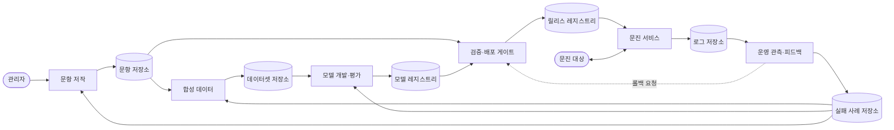

# 문진 시스템 구조

이 문서는 설계서(`ARCHITECTURE_FULL.md`)의 에이전트용 요약이자, 영역 작업이 따르는 구조의 기준이다. 설계서와 어긋나는 곳을 발견하면 임의로 고치지 말고 헤드에게 알린다.

표기: 확인은 리포지토리 문서에서 직접 확인한 것, 제안은 이 설계의 제안, 미정은 결정이 필요한 것(`DECISIONS.md`)이다.

> v2 정렬(2026-10-27, D74~D84): 모델 입출력과 턴 처리 서술을 학습 데이터셋 v2 기준으로 고쳤다. 정규화·절차·다음 문항은 LoRA-A가 하고 서비스는 표 찾기·저장·안전장치만 한다. 흐름 도식은 `PROJECT_STRUCTURE.md` 3-1절. 영역·저장소·교환 구조(3~6절)는 그대로다.

## 1. 한눈에

경계 계약(boundary-contracts)은 영역 사이 화살표를 오가는 JSON의 형식을 정의한다. 문진 서비스 내부 컴포넌트의 형식은 문진 스키마(contracts)가 정의한다. 화살표는 데이터가 움직이는 방향이며, 영역에서 저장소로 가면 쓰기, 저장소에서 영역으로 가면 읽기다.

## 2. 영역 7개

| # | 영역 | 리포지토리 | 소유 저장소 | 하는 일 | 시드 컴포넌트(참고, 구속 아님) |
| --- | --- | --- | --- | --- | --- |
| 1 | 문진 서비스 | survey-service | Session Store(서비스 내부) | 발화 한 턴을 정형 값으로 바꾸고 응답한다 | Orchestrator, 추출기 호출(LoRA-A), 출력 사후 검증, 세션 저장, 표 찾기(질문 문장·`ask` 틀·칸 설명), 응답기 호출(LoRA-B), 릴리스 로더, 트레이스 내보내기, 추론 서버. v1의 Normalizer, Judge, Record Writer, Planner 코드는 두지 않는다(D74) |
| 2 | 문항 저작 | question-authoring | 문항 저장소 | 관리자가 문항을 추가·수정하고 검수받는다 | 저작 콘솔, 템플릿, 코드·단위 사전, 초안 변환기, 계약·의미 검증기, 규칙 미리보기, 변경 영향 분석기, 검수 워크플로, 문항 버전 관리자, 개선 신호 수신함 |
| 3 | 합성 데이터 | synthetic-data | 데이터셋 저장소 | 학습·평가 데이터를 계약 형식으로 만든다 | 시나리오 설계기, 시드 수집기, 정답 구성기, 발화 생성기, STT 노이즈 주입기, 응답 문장 생성기, 품질 검사기, 감수 샘플링, 분할기, 패키저 |
| 4 | 모델 개발·평가 | model-lab | 모델 레지스트리 | LoRA-A·B를 학습·평가해 패키지로 올린다 | 데이터셋 로더, LoRA-A·B 학습기, 실험 추적기, Parser·Generator 평가기, 턴 시뮬레이터, 회귀 평가기, 보고서 작성기, 모델 패키저 |
| 5 | 검증·배포 게이트 | release-gate | 릴리스 레지스트리 | 문항·모델 조합을 검사해 출고한다 | 후보 수집기, 계약 호환·문항-모델 호환 검사기, 승인 평가 실행기, 임상·안전 검사, 릴리스 구성기, 판정 기록기, 롤백 관리자 |
| 6 | 운영 관측·피드백 | ops-feedback | 로그 저장소, 실패 사례 저장소 | 기록을 비식별해 실패 사례를 선별한다 | 로그 수집기, 비식별 처리기, 실패 탐지기, 사례 분류기, 사람 검토 큐, 지표 대시보드, 피드백 배포기 |
| 7 | 경계 계약 | boundary-contracts | 계약 패키지 | 영역 사이 교환의 형식을 정의하고 검증한다. 헤드 소유(D19) | 요구사항 케이스, 계약 원본, 업무 규칙, 정적 예시, `verify.py`, 배포 스키마 |

문진 서비스의 컴포넌트(Frontend, Orchestrator, Staff Console, Result Dispatcher, Question Bank, Session Store)와 그 계약은 리포지토리에서 확인한 것이다. Parser, Normalizer, Judge, Record Writer, Planner, Generator는 v1 컴포넌트 이름이다. v2에서는 LoRA-A(`ActionExtraction`)와 LoRA-B(`ResponseText`)가 이 일을 대신하며, 이 문서가 읽은 문진 스키마의 해당 계약 12개는 삭제됐다(G11, D79). 릴리스 로더, 트레이스 내보내기, 그리고 나머지 영역의 컴포넌트는 모두 제안이다.

## 3. 저장소 6개와 계약 패키지

| 저장소 | 소유 영역 | 쓰기 경계 | 읽는 영역 |
| --- | --- | --- | --- |
| 문항 저장소 | 문항 저작 | 저작 서비스 API(유일한 쓰기 창구) | 합성 데이터, 게이트, 문항 저작, 모델 개발·평가(D13) |
| 데이터셋 저장소 | 합성 데이터 | 게시 SDK(불변 버전) | 모델 개발·평가 |
| 모델 레지스트리 | 모델 개발·평가 | 게시 SDK(불변 패키지) | 게이트, 모델 개발·평가 |
| 릴리스 레지스트리 | 검증·배포 게이트 | 게이트 서비스 API(활성 포인터는 원자적 변경) | 문진 서비스, 운영 관측·피드백, 판정 조회가 필요한 문항 저작·모델 개발·평가 |
| 로그 저장소 | 운영 관측·피드백 | 수집 API(서비스가 보냄) | 운영 관측·피드백 내부의 비식별 처리기만 |
| 실패 사례 저장소 | 운영 관측·피드백 | 게시 SDK | 합성 데이터, 모델 개발·평가, 문항 저작 |
| 계약 패키지 | 계약·스키마 | 패키지 릴리스 | 모든 영역 |

서비스 안의 Question Bank는 문항 저장소와 별개다. 문항 저장소가 원본이고, Question Bank는 릴리스 레지스트리의 묶음을 적재한 서빙 사본이다.

## 4. 리포지토리 11개와 의존

| 리포지토리 | 종류 | 의존할 수 있는 것 |
| --- | --- | --- |
| head | 설계 문서, 결정, 브리프 | 없음 |
| boundary-contracts | 영역 7. 영역 사이 계약, 헤드 소유 | 문진 스키마(참조만) |
| turn-engine | 공유 라이브러리(LoRA-A 출력의 사후 검증 `validate_extraction`과 `QuestionFlowTable`. v1의 정규화·판정·기록·Plan은 v0.4.0에서 제거) | boundary-contracts |
| model-runtime | 공유 라이브러리와 추론 서버(어댑터 로딩, 프롬프트 템플릿 `prompt-4`, 제약 디코딩·출력 형식 보장) | 문진 스키마(정수 버전 확인용), boundary-contracts |
| survey-service | 영역 1. 문진 스키마(`schema/`)를 이 리포지토리 안에 포함하고 소유한다(D29) | boundary-contracts, turn-engine, model-runtime, 릴리스 읽기 SDK, 로그 수집 SDK |
| question-authoring | 영역 2 | 문진 스키마, boundary-contracts, turn-engine(규칙 미리보기), 실패 사례 읽기 SDK |
| synthetic-data | 영역 3 | 문진 스키마, boundary-contracts, turn-engine, 문항 읽기 SDK, 실패 사례 읽기 SDK |
| model-lab | 영역 4 | 문진 스키마, boundary-contracts, turn-engine, model-runtime, 데이터셋 읽기 SDK, 실패 사례 읽기 SDK, 문항 읽기 SDK(D13) |
| release-gate | 영역 5 | 문진 스키마, boundary-contracts, turn-engine, model-runtime, 문항·모델 읽기 SDK |
| ops-feedback | 영역 6 | 문진 스키마, boundary-contracts, 릴리스 읽기 SDK, 게이트의 롤백 요청 API |
| deploy | 배포 | 각 리포가 게시한 이미지 digest만 |

공유 라이브러리를 분리한 이유는 학습·평가가 서비스와 같은 동작을 재현해야 하기 때문이다.

## 5. 경계 규칙(구속)

1. 영역은 서로 직접 호출하지 않고 저장소로만 데이터를 주고받는다. 저장소의 쓰기 권한은 한 영역에만 준다.
2. 영역 리포지토리끼리 코드를 가져오지 않는다. 이웃의 데이터는 소유자가 배포한 읽기 SDK로만 읽는다.
3. 의존 방향은 문진 스키마·boundary-contracts ← turn-engine·model-runtime ← 영역 리포지토리의 한 방향이다.
4. API와 SDK는 이 순서로 고른다. (1) 같은 프로세스에서 같은 순수 로직이 필요하면 라이브러리. (2) 불변 버전으로 게시하고 읽는 쪽이 가져가면 저장소와 읽기 SDK. (3) 쓰기 권한·원자성·감사를 서버에서 강제해야 하면 소유자의 서비스 API. (4) 독립 확장·장애 격리가 필요하면 네트워크 API. 소비자는 소유자가 배포한 SDK 인터페이스에만 의존하므로, 소유자는 SDK 뒤의 구현을 바꿀 수 있다.
5. 문진 서비스에는 게이트가 승인한 문항·모델 묶음만 들어간다.
6. 모든 레코드는 따르는 계약 버전을 적고, 쓸 때 계약 스키마로 검증한다. 불변 레코드는 고치지 않고 새 버전을 만든다.
7. 게이트의 판정(통과·반려)은 릴리스 레지스트리에 조합 단위로 기록하고, 다른 영역은 읽기 SDK로 조회한다.
8. 로그 저장소의 원본은 비식별 처리기만 읽는다.
9. 평가셋은 합성 학습 데이터와 분리해 관리한다.
10. 데이터셋·모델·릴리스 매니페스트에 turn-engine과 model-runtime의 버전을 기록한다.
11. ~~모델은 발화 해석과 문장 생성만 하고 판단은 코드가 한다.~~ v2(D74)에서 바뀌었다: 정규화·절차·다음 문항은 LoRA-A가 정한다. 코드는 결정을 대신하지 않고 **출력을 검증**한다(`validate_extraction`, D75). 위반이면 값을 지어내지 않고 턴을 실패로 처리해 세션을 바꾸지 않는다. 안전과 닿는 고정 문장은 서비스가 쓴다.
12. 계약의 소유는 경계로 가른다. 두 리포지토리 이상이 주고받는 것은 경계 계약이며 헤드가 소유해 `boundary-contracts`에 둔다. 한 리포지토리 안의 컴포넌트 사이 계약은 그 영역 에이전트가 소유하고 `docs/design.md`에 둔다. 단 문진 서비스 영역의 컴포넌트 계약은 영역을 넘어 공유되어 문진 스키마(`survey-service/schema`)에 있고, 그 소유는 문진 서비스 영역이다(D19). 내부 계약이 다른 리포지토리에 닿게 되면 변경 요청으로 올려 경계 계약이 된다. 

## 6. 영역 간 교환

호출 가능한 인터페이스의 시그니처, 오류, 멱등성은 `../boundary-contracts/INTERFACES.md`(I1~I10)와 `CONVENTIONS.md`가 정한다. 아래 표는 데이터가 어디서 어디로 가는지의 개요다.

| ID | 보내는 쪽 → 받는 쪽 | 데이터 | 계약 |
| --- | --- | --- | --- |
| E01 | 관리자 → 문항 저작 | 문항 내용 | 화면 입력 |
| E02 | 문항 저작 → 문항 저장소 | 문항 정의 버전, 검수 기록, 변경 분류 | QuestionBank(확인), ReviewRecord, ChangeClassification |
| E03 | 문항 저장소 → 합성 데이터 | 문항 정의 | QuestionBank |
| E04 | 합성 데이터 → 데이터셋 저장소 | 학습·검증·평가셋, 매니페스트 | ActionExtractionSample(LORA_A), ResponseSample(LORA_B), DatasetManifest (v1의 ParserSample, GeneratorSample은 삭제) |
| E05 | 데이터셋 저장소 → 모델 개발·평가 | 지정 버전의 데이터셋 | 위와 같음 |
| E06 | 모델 개발·평가 → 모델 레지스트리 | 모델 패키지 | ModelPackageManifest |
| E07 | 문항 저장소 → 게이트 | 후보 문항 버전, 검수 기록, 변경 분류 | QuestionBank, ReviewRecord, ChangeClassification |
| E08 | 모델 레지스트리 → 게이트 | 게이트 대기 모델 패키지 | ModelPackageManifest |
| E09 | 게이트 → 릴리스 레지스트리 | 릴리스 매니페스트, 활성 포인터 변경 | ReleaseManifest |
| E10 | 게이트 → 릴리스 레지스트리 | 조합별 판정(통과·반려)과 사유 | GateDecision |
| E11 | 릴리스 레지스트리 → 문진 서비스 | 활성 묶음 | ReleaseManifest |
| E12 | 문진 대상 ↔ Frontend | 발화 글자(STT 결과), 응답 문장(TTS 입력) | FrontendMessage, FrontendInput(확인) |
| E13 | Orchestrator ↔ Session Store | 세션 조회, 한 턴의 쓰기 묶음 | SessionLoad·SessionCommit 요청·결과(초안, 확인) |
| E14 | 문진 서비스 → 로그 저장소 | 턴 단위 Trace, 업무 로그 | TurnTrace, LogEntry(확인) |
| E15 | 로그 저장소 → 운영 관측 | Trace 원본 | 위와 같음 |
| E16 | 운영 관측 → 실패 사례 저장소 | 비식별·분류·검토된 사례 | FailureCase |
| E17 | 실패 사례 저장소 → 합성 데이터 | 시드 사례 | FailureCase |
| E18 | 실패 사례 저장소 → 모델 개발·평가 | 정답이 붙은 회귀 케이스 | FailureCase |
| E19 | 실패 사례 저장소 → 문항 저작 | 문항별 실패율, 혼동 사례 | FailureCase |
| E20 | 운영 관측 → 게이트 | 롤백 요청 | RollbackRequest |
| E21 | 문진 서비스 → Staff Console, Result Dispatcher | 직원 알림, 확정된 문진 결과 | StaffConsoleInput, DispatchInput(확인) |
| E22 | 계약 패키지 → 모든 영역 | JSON Schema | 배포 스키마(확인) |

원칙: 읽는 쪽이 가져가는 방식을 기본으로 하고 이벤트는 새 버전 알림만 담는다. 쓰기는 같은 ID로 다시 보내도 결과가 같게(멱등) 만든다. 문진 서비스는 한 턴을 처리하는 동안 만드는 쪽 영역을 호출하지 않는다.

## 7. 계약 현황

기존 계약(문진 스키마, 확인; 아래 모델 입출력 12개는 v2에서 삭제됐다. 모델 입출력은 `boundary-contracts`의 `ActionExtractionInput`·`ActionExtraction`·`ResponseRequest`·`ResponseText`다): ~~UtteranceParserInput·ParserOutput, AnswerNormalizerInput·NormalizerOutput, AnswerJudgeInput·JudgeOutput, RecordWriterInput·StoreResult, DialoguePlannerInput·PlannerOutput, ResponseGeneratorInput·GeneratorOutput~~, FrontendMessage·FrontendInput, OrchestratorInput·OrchestratorOutput, TurnTrace, LogEntry, StaffConsoleInput·InterventionDecision, DispatchInput·DispatchOutput, QuestionBank, SessionStore, SessionLoad·SessionCommit 요청·결과(초안).

신규 계약 11개(필드는 제안이며 확정이 아니다). `boundary-contracts`에 두며, ReleaseManifest·GateDecision·TraceEnvelope는 초안이 있다.

| 계약 | 만드는 영역 | 쓰는 영역 | 핵심 필드(제안) |
| --- | --- | --- | --- |
| ReviewRecord | 문항 저작 | 게이트 | 문항 세트 ID, 버전, 검수자 역할, 결정, 사유, 임상 기준 승인 여부, 시각 |
| ChangeClassification | 문항 저작 | 합성 데이터, 게이트 | 문항 세트 ID, 이전·새 버전, 변경 종류, 영향 슬롯 참조, 필요 후속 작업 |
| ActionExtractionSample (v1: ParserSample) | 합성 데이터 | 모델 개발·평가 | sample_id, scenario_id, split, origin, 입력(ActionExtractionInput), 정답(ActionExtraction). v1의 `noise_types`, `style_guide_version`, `runtime_contract_version`은 뺐다 |
| ResponseSample (v1: GeneratorSample) | 합성 데이터 | 모델 개발·평가 | 같은 모양, 입력(ResponseRequest), 정답(ResponseText 문자열) |
| DatasetManifest | 합성 데이터 | 모델 개발·평가 | 데이터셋 ID, 버전, 계약 버전, 문항 버전 목록, 생성기 버전, 시드 사례 ID, 분할별 개수, 파일 해시 |
| ModelPackageManifest | 모델 개발·평가 | 게이트, 서비스 | 역할(A·B), 버전, 기반 모델, 어댑터 해시, 서빙 설정, system_prompt{path, sha256}(2.0.0부터 필수, D75), 학습 계보, 평가 리포트 참조(상태는 없음, D25) |
| ReleaseManifest | 게이트 | 서비스 | 릴리스 ID, 문항 세트 버전, LoRA-A 버전, LoRA-B 버전, 계약 버전, 판정 기록 참조, 내용 해시 |
| GateDecision | 게이트 | 문항 저작, 모델 개발·평가, 서비스, 운영 관측 | 판정 ID, 대상 조합, 결과(통과·반려), 검사별 결과와 근거, 반려 사유, 승인자, 시각, 통과 시 릴리스 ID |
| TraceEnvelope | 문진 서비스 | 운영 관측·피드백 | 릴리스 ID, 런타임 계약 버전, 세션 ID, 턴 ID, 전송 시각, TurnTrace 본문(E14) |
| FailureCase | 운영 관측·피드백 | 합성 데이터, 모델 개발·평가, 문항 저작 | 사례 ID, 출처 릴리스 ID, 비식별 Trace 참조, 실패 유형, 탐지 방법, 정답(선택), 검토 상태 |
| RollbackRequest | 운영 관측·피드백 | 게이트 | 현재·되돌릴 릴리스 ID, 사유, 근거 지표 참조 |

TurnTrace에는 릴리스 ID가 없다. 문진 스키마를 고치지 않고 TraceEnvelope가 붙인다(D19).

## 8. 외부 진입점과 세션(제안)

- 외부 클라이언트는 gateway의 공개 주소와 공개 API 명세만 안다. 어느 서비스가 처리하는지는 gateway가 경로로 나눠 전달한다.
- 키오스크 Frontend는 다른 팀이 만든다(외부 접점, 확인). 우리는 공개 API 명세를 소유하고 문진 스키마에서 생성한다. 최소 동작은 세션 시작, 발화 전달(세션 ID와 턴 ID, 같은 턴 ID로 다시 보내도 결과가 같음), 세션 종료, 상태 확인이다.
- 관리자 콘솔 UI는 question-authoring 안에서 직접 만들되 저작 API의 클라이언트로만 구현해 나중에 분리할 수 있게 한다.
- 세션은 한 사람의 한 번의 문진이다(공용 키오스크 가정). 시작은 Frontend가 세션 시작을 호출할 때이고, 종료는 문진 완료, 종료 호출, 일정 시간 입력 없음 중 하나다. 종료된 세션은 다시 열지 않고 장애 뒤에도 자동으로 이어가지 않는다. 문진 대상 참조, 인증, 전송 방식은 미정(O06)이다.

## 9. 배포 구성(제안)

- 운영 환경은 단일 서버이고 Docker Compose로 합친다. deploy 리포지토리가 Compose 파일, 이미지 digest 잠금 파일, 네트워크·볼륨·저장소별 데이터베이스와 계정, 헬스체크, 백업·복구 스크립트를 가진다.
- 상시 서비스는 gateway, orchestrator, inference(GPU), authoring-app, ingest-api, gate-service와 저장소다. 합성 데이터·모델 학습·평가·분석은 필요할 때만 도는 작업이다. 학습·평가·합성은 운영 서버 밖에서 돌리고 결과만 저장소에 게시하기를 권한다.
- 코드와 내용은 두 축으로 나눠 배포하고 각각 되돌린다. 코드는 deploy의 digest 잠금 파일을, 내용은 릴리스 레지스트리의 활성 포인터를 되돌린다. 두 축은 계약 버전으로 만나며, 로더는 지원하지 않는 계약 버전의 묶음을 거부한다.
- 네트워크는 edge, serving, authoring, release, logs로 나눈다. 저장소마다 데이터베이스와 계정을 나누고 다른 영역에는 읽기 전용 계정만 준다.
- 서버 전체가 멈추면 시스템은 알리지도 위험을 감지하지도 못한다. 이는 비보증으로 명시하고, 서버 밖의 외부 감시가 유지보수 담당에게 알린다. 현장의 대체 절차는 이 프로젝트의 범위 밖이다.

## 10. 구속과 참고

구속: 이 문서의 3~7절(저장소, 리포지토리와 의존, 경계 규칙, 교환, 계약)과 8·9절의 경계에 닿는 항목. 참고(시드): 2절의 컴포넌트 목록, 설계서의 내부 흐름 그림과 시나리오. 영역 에이전트는 경계만 지키면 내부를 바꿀 수 있다.

결정 현황은 `DECISIONS.md`에 있다.
