# 아키텍처: 흐름, 시퀀스, 상태, 배포

이 문서는 문진 시스템 워크스페이스(리포 13개)의 지금까지 알려진 구조를 도식으로 보여 준다. 리포별 목록과 큰 흐름 한 장은 [`PROJECT_STRUCTURE.md`](PROJECT_STRUCTURE.md)가 다룬다. 이 문서는 그것이 다루지 않는 영역 의존 지도, 순환 파이프라인의 단계, 한 턴의 시퀀스, 그래프, 출고 승인, 비식별, 배포, 서버 배치, 버전 관계를 깊이 다룬다. 결정의 근거는 [`DECISIONS.md`](DECISIONS.md)(D01~D71), 계약은 `../../boundary-contracts/`의 `INTERFACES.md`, `HTTP.md`, `PUBLIC_API.md`, `CONVENTIONS.md`, `METRICS.md`에 있다.

작성 기준일은 2026-10-26이다. 이 문서의 모든 도식은 아래 파일을 읽고 그렸다. 서비스와 도커는 실행하지 않았다.

## 0. 상태 표시와 읽는 법

각 도식과 표의 항목에는 확인 수준을 붙였다.

| 표시 | 뜻 |
|---|---|
| [확인됨] | 서비스끼리 실제 HTTP로 도는 전체 시험(`deploy/scripts/e2e.sh`, 전체 모드 87 PASS / 0 FAIL, 개발 PC)에서 확인 |
| [구현됨] | 해당 리포의 단위·스모크 시험으로만 확인. 서비스끼리 E2E로는 확인하지 못함 |
| [제안/가정] | 설계의 제안이거나 사용자가 가정으로 정한 것. 바뀔 수 있음 |
| [미정] | 결정이 필요하거나 확인하지 못한 것 |
| [시험용 대체] | E2E에서 가짜 백엔드, 시험용 어댑터, 시험용 토큰 등으로 대신한 것 (`TEST-SUB`) |

도식 아래의 "근거"는 그 도식을 그릴 때 읽은 파일과 결정 번호다. 경로는 워크스페이스 루트(`healthKiosk/`) 기준이다.

참고: `head/docs/STATUS.md`는 2026-10-15 상단의 "현재 단계" 문구가 오래되었다(구조 확정 단계로 적혀 있음). 이 문서는 STATUS.md의 완료 목록과 `deploy/docs/STATUS.md`, `PROJECT_STRUCTURE.md` 5절의 최신 내용을 따랐다.

## 1. 한눈에 보는 다이어그램 목록

| 도식 | 절 | 내용 |
|---|---|---|
| A | 2 | 영역·리포 의존 지도 |
| B | 3 | 큰 순환 파이프라인 |
| C | 4 | 운영 한 턴 시퀀스 |
| D | 5 | survey-service LangGraph 그래프 |
| E | 6 | 출고 승인 시퀀스와 제출 상태 |
| F | 7 | 비식별·피드백 흐름 |
| G | 8 | 배포 구성도 (Compose, 게이트웨이, 레지스트리) |
| H | 9 | 서버 배치와 환경 |
| I | 10 | 계약·버전 관계 |
| - | 11 | 알려진 빈 곳과 미정 |

---

## 2. 도식 A: 영역·리포 의존 지도

리포는 13개이고 의존은 한 방향이다: 문진 스키마와 boundary-contracts, 그 위에 turn-engine과 model-runtime, 그 위에 영역 리포(D02, STRUCTURE.md 5절). 영역 사이 호출은 코드를 가져오는 대신 HTTP 서비스 API로 한다(D49). 가장자리 영역은 사람 또는 다른 팀과 맞닿는 곳이다: 환자 키오스크 화면(`kiosk-frontend`, 떼어 낼 수 있는 별도 영역, D65), 직원 콘솔, 출고 승인과 실패 사례 검토를 하는 사람(`admin-console`, D68), 문항 저자.

```mermaid
flowchart TB
  classDef edge fill:#fde7c8,stroke:#b9770e,stroke-width:2px,color:#000
  classDef lib fill:#dbe9f7,stroke:#2e6da4,color:#000
  classDef svc fill:#e2f0d9,stroke:#4f8a2f,color:#000
  classDef job fill:#f0e6f7,stroke:#7d4ba0,color:#000
  classDef dep fill:#eeeeee,stroke:#666,color:#000
  classDef human fill:#fff,stroke:#b9770e,stroke-dasharray:4 3,color:#000

  subgraph SHARED["공유 계약 · 라이브러리 (코드로 의존, 태그 설치)"]
    BC["boundary-contracts<br/>경계 계약 스키마 · HTTP 규약 · clients<br/>소유: 헤드"]:::lib
    SCH["survey-service/schema<br/>문진 스키마 (정수 버전)<br/>소유: survey-service"]:::lib
    TE["turn-engine<br/>턴 결정 규칙 (순수 라이브러리)"]:::lib
    MR["model-runtime<br/>추론 런타임 · 추론 서버"]:::lib
  end

  subgraph SERV["서비스 (Compose에서 상시 실행)"]
    SS["survey-service<br/>문진 서비스 (LangGraph)"]:::svc
    MS["model-serving<br/>추론 서버 (이미지 이름, 소스는 model-runtime)"]:::svc
    RG["release-gate<br/>검사 · 승인 · 릴리스 · 활성 포인터"]:::svc
    QA["question-authoring<br/>문항 저작 · 문항 저장소"]:::svc
    OF["ops-feedback<br/>수집 · 비식별 · 실패 사례"]:::svc
    REG["model-registry<br/>이미지 이름, 소스는 model-lab"]:::svc
  end

  subgraph JOBS["작업형 (주기 잡 · 서버 밖 GPU)"]
    SD["synthetic-data<br/>합성 데이터"]:::job
    ML["model-lab<br/>학습 · 평가 · 패키징"]:::job
  end

  subgraph SCREEN["화면 (정적 웹)"]
    KF["kiosk-frontend<br/>환자 키오스크 · 직원 콘솔"]:::edge
    AC["admin-console<br/>출고 승인 · 실패 사례 검토"]:::edge
  end

  subgraph DEPLOYG["배포 · 결정"]
    GW["게이트웨이 Caddy<br/>인증 · 토큰 주입"]:::dep
    DP["deploy<br/>Compose · 이미지 잠금 · E2E"]:::dep
    HD["head<br/>결정 · 브리프 · 계약 소유"]:::dep
  end

  P(["환자"]):::human
  ST(["직원"]):::human
  AP(["출고 승인자 (release-approver)"]):::human
  RV(["실패 사례 검토자 (reviewer)"]):::human
  AU(["문항 저자 (의료인)"]):::human

  P --> KF
  ST --> KF
  AP --> AC
  RV --> AC
  KF --> GW
  AC --> GW
  GW --> SS
  GW --> RG
  GW --> OF
  AU -.->|"저작 화면: 이 프로젝트 범위 밖 [미정]"| QA

  SS -->|"I9 parse · generate"| MS
  SS -->|"I4 활성 포인터 · 번들"| RG
  SS -->|"I6 Trace 전송"| OF
  MS -->|"I4 번들 읽기"| RG
  RG -->|"I1 문항 · 검수"| QA
  RG -->|"I3 모델 패키지"| REG
  ML -->|"I3 게시"| REG
  SD -->|"I1 문항"| QA
  ML -->|"I2 데이터셋 (파일 저장소)"| SD
  OF -->|"I5 롤백 요청"| RG
  SD -->|"I7 실패 사례 시드"| OF
  ML -->|"I7 회귀 평가"| OF
  QA -->|"I7 개선 신호"| OF

  SS -.->|"import"| TE
  SS -.->|"스키마"| SCH
  MS -.->|"import"| MR
  ML -.->|"import"| MR
  BC -.->|"모든 영역이 의존 (태그)"| SERV
  BC -.-> JOBS
  DP -.->|"digest로 기동 · 검증"| SERV
  HD -.->|"소유 · 변경 요청 처리"| BC
```

해석:

- 실선은 런타임 HTTP 호출(I번호는 `INTERFACES.md`), 점선은 빌드 시 의존이나 소유 관계다.
- I2(데이터셋)는 HTTP가 아니라 같은 호스트(GPU 호스트)의 파일 저장소다(D49).
- 상태: 서비스끼리의 HTTP 연결은 [확인됨]. 단 모델은 [시험용 대체](가짜 백엔드)이고, `model-lab`의 실제 학습은 gpu-dev에서 따로 한 바퀴 확인했을 뿐 E2E에는 시험용 어댑터가 쓰였다. 문항 저작 화면은 구현 범위 밖이다.
- 키오스크 프론트(`kiosk-frontend`)는 다른 팀 담당이던 외부 접점을 분리 가능하게 만든 것이다(D12, D65). 이 리포를 통째로 바꿔도 나머지는 영향받지 않는 것이 목표다.

근거: `head/docs/STRUCTURE.md` 3~6절, `PROJECT_STRUCTURE.md` 1~3절, `deploy/compose.yaml`, `boundary-contracts/HTTP.md`, D02, D05, D12, D49, D65, D68.

---

## 3. 도식 B: 큰 순환 파이프라인

문항에서 시작해 모델과 릴리스를 거쳐 운영에 이르고, 운영에서 나온 실패 사례가 다시 문항·데이터·평가·롤백으로 돌아오는 고리다. 단계 번호는 `head/docs/E2E.md`의 합격 시나리오 1~9와 같다. 모델 성능은 이 순환의 완성 기준이 아니다(D38, D61): 순환이 닫히는지만 본다.

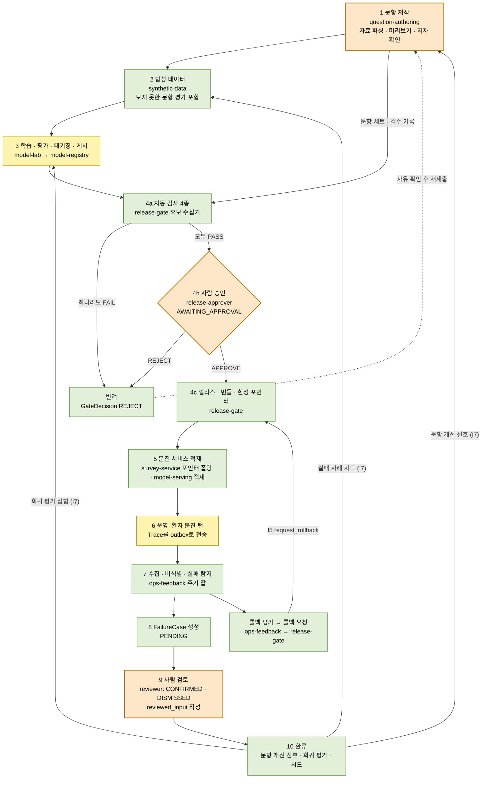

| 단계 | 상태 | 비고 |
|---|---|---|
| 1 문항 저작 | [확인됨] I1 HTTP 읽기·검수·변경 분류까지 | 저작 화면은 구현 범위 밖 [미정], 지원 문서 형식은 영역이 정함(D33) |
| 2 합성 데이터 | [확인됨] run-once, 평가가 학습과 겹치지 않음 | 규칙 기반 생성기. LLM 생성기는 후속 |
| 3 학습·평가·패키징 | [시험용 대체] E2E는 시험용 어댑터·고정 지표 보고서 | gpu-dev에서 Qwen2.5-1.5B 4비트로 한 바퀴는 별도 확인(STATUS.md 2026-10-15). `E2E_GPU=1` 경로는 미검증(기본 끔) |
| 4 검사·승인·릴리스 | 자동 검사·릴리스·번들·활성화 [확인됨], 승인자는 [시험용 대체](스크립트가 시험용 토큰으로 결정) | 승인 화면은 admin-console, 게이트웨이 경유 한 번은 E2E 4g에서 확인 |
| 5 서비스 적재 | [확인됨] 실제 survey-service가 포인터를 폴링해 적재 | 모델은 가짜 백엔드 [시험용 대체] |
| 6 운영 턴 | [확인됨] 게이트웨이 경유 공개 API 한 턴 | 한국어 STT 등 실제 브라우저 경로는 [미정] |
| 7~8 수집·비식별·사례 | 수집·잡·FailureCase [확인됨] | 봉투는 E2E가 만든 시험 자료 [시험용 대체] |
| 9 사람 검토 | 검토 POST·`reviewed_input`·`reviewed_by` [확인됨] (E2E 7g, 7h) | 검토 화면 렌더링은 [미정] |
| 10 환류 | synthetic-data의 I7 시드 인용과 question-authoring의 개선 신호(`GET /v1/signals`)는 [확인됨] (E2E 7단계). model-lab의 확정 사례 회귀 평가는 [구현됨]이며 E2E에서는 실행하지 않음 | `deploy/docs/STATUS.md` 셋째·일곱째 구간, D52, CR-D12 |
| 롤백 | [확인됨] 요청 → APPLIED → 서비스가 이전 릴리스로 복귀 | 자동 판단 기준(실패율, 최소 턴)은 사용자 결정 전이라 기본값 없음 [미정] |

근거: `head/docs/E2E.md`, `deploy/docs/STATUS.md`(넷째~열째 구간), `release-gate/docs/design.md` 2~4·9절, `ops-feedback/docs/design.md` 9절, D32, D38, D52, D53, D57, D61.

---

## 4. 도식 C: 운영 한 턴 시퀀스

환자의 발화 하나를 처리하는 한 턴이다. 브라우저는 게이트웨이만 부른다. 게이트웨이가 경로에 맞는 서버 토큰을 붙인다(키오스크 경로는 `SURVEY_KIOSK_TOKEN`, 직원 경로는 `SURVEY_STAFF_TOKEN`; 토큰 값은 이 문서에 없다).

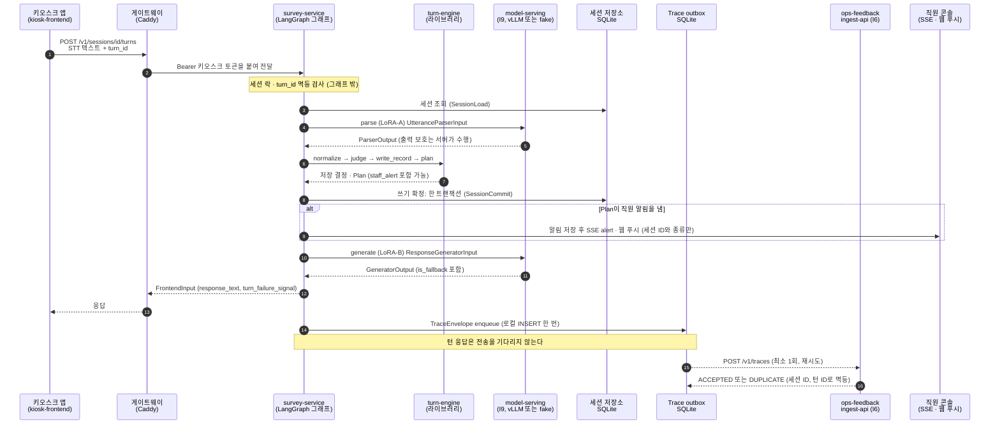

### 4.1 위험 정지와 재개

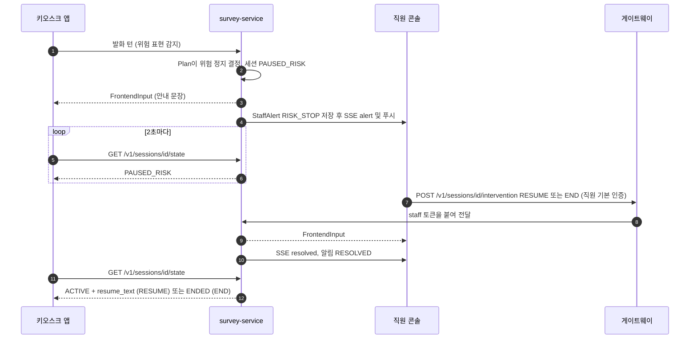

| 항목 | 상태 | 근거 |
|---|---|---|
| 게이트웨이 경유 공개 API 한 턴, 같은 `turn_id` 재전송 시 같은 응답 | [확인됨] | E2E 5단계, `PUBLIC_API.md` |
| parse·generate가 model-serving을 거침 | [확인됨] 고정 출력 "(가짜 응답)" 확인, 모델은 [시험용 대체] | `deploy/docs/STATUS.md` 다섯째 구간 |
| 추론 서버를 멈추면 그 턴만 실패하고 서비스는 살며, 다시 띄우면 다음 턴이 복구 | [확인됨] | 같은 곳 |
| Trace outbox 전송, DUPLICATE도 전달 완료로 취급 | [확인됨] (봉투는 E2E가 만든 시험 자료) | `survey-service/docs/design.md` 6절, D16 |
| 위험 정지 → 직원 RESUME/END → state ACTIVE+resume_text → 알림 RESOLVED, SSE alert/resolved | [확인됨] 위험 문구 스위치는 시험 구성 전용(`TEST-RISK`) [시험용 대체] | E2E 5f, `compose.test.yaml` |
| 웹 푸시 수신 (VAPID 키, HTTPS 필요) | [미정] BLOCKED. 키가 없으면 푸시 없이 SSE만 동작 | `survey-service/docs/design.md` 15절, D64 |
| 직원 알림이 안 닿으면 `DELIVERY_FAILED`, 프론트는 현장 직원 호출 화면 | [구현됨] | `PUBLIC_API.md`, `design.md` 15절 |
| 처리 표(세션 상태 × 입력 종류) | [구현됨] 골든 대조 1220쌍 중 1215 일치, 5건은 예시 오류 | `design.md` 3절, D44 |

설명:

- 모델은 해석(파서)과 문장 생성만 하고, 판단은 turn-engine 코드가 한다(STRUCTURE.md 5절 규칙 11).
- 쓰기 확정이 실패하면 확정 뒤의 일은 하지 않는다. 확정 뒤의 일(직원 알림, 결과 전달, 응답 생성)은 서로의 성패와 무관하게 시도한다(`design.md` 3절 7~8항).
- 위험 정지 중인 세션은 유휴 만료로 닫지 않는다(D66).
- 새 세션만 새 릴리스에 묶이고, 진행 중 세션은 자기 릴리스로 끝까지 간다. 턴 처리 중에는 이웃(I4)을 부르지 않는다(`design.md` 5절).

근거: `survey-service/docs/design.md` 3·5·6·15절, `boundary-contracts/PUBLIC_API.md`, `HTTP.md`(I6, I9), `deploy/config/Caddyfile`, D16, D36, D55, D58, D62, D64, D66.

---

## 5. 도식 D: survey-service LangGraph 그래프

한 턴의 오케스트레이션은 LangGraph `StateGraph`로 만들어져 있다(D62). 노드 이름은 `survey-service/docs/design.md` 14.1절에서 확인한 것만 썼다: `load_session`, `fail_no_session`, `col_none`, `col_progress`, `col_paused`, `col_ended`, `ignore`, `bind_release`, `parse`, `normalize`, `judge`, `write_record`, `plan`, `commit`, `deliver_staff`, `dispatch_result`, `generate`, `finalize`. 설계서는 "노드 약 20개"라고 적었는데 14.1절 그림에서 이름이 확인되는 것은 위 18개다. 나머지 노드가 있는지는 `survey_service/graph.py`를 읽지 않아 [미정]이다.

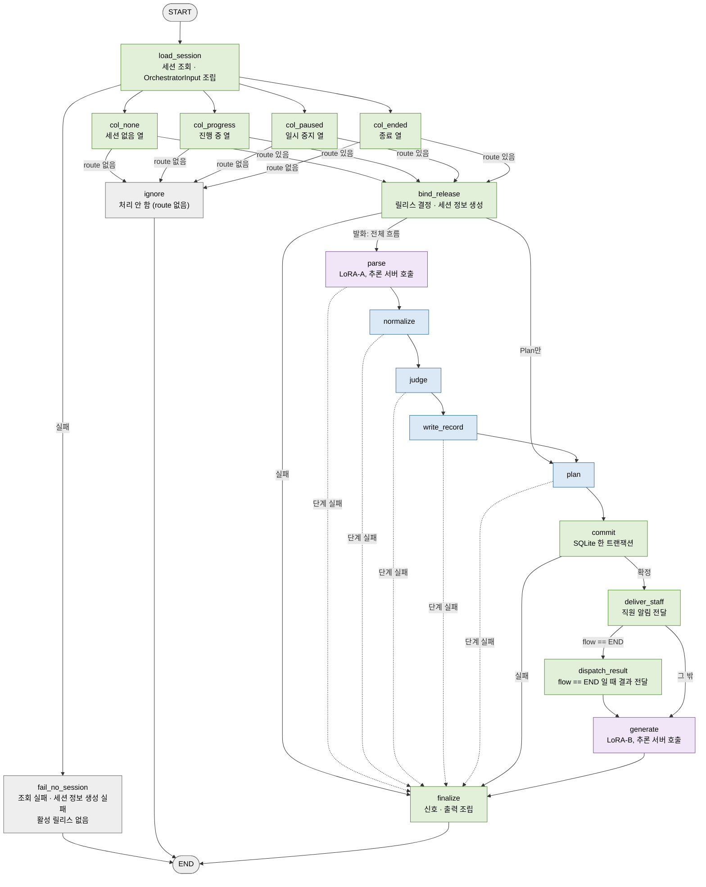

읽는 법:

- 파란색 노드(`normalize`, `judge`, `write_record`, `plan`)는 turn-engine의 순수 결정 함수를 호출하는 노드다(D62 방침 1). 보라색 노드(`parse`, `generate`)는 추론 서버(I9)를 HTTP로 부른다. 어느 노드가 turn-engine의 어느 함수를 부르는지는 설계서 14절에 노드별 대응이 적혀 있지 않아, 이 색 구분은 3절 처리 흐름("Parser → normalize → judge → write_record → plan")을 따른 것이다.
- 열 노드(`col_*`)가 설계서 9-1 처리 표의 열(세션 상태)이고, 행(입력 종류)은 각 열 노드 안의 표에 있다. 표는 `COLUMNS` 한 곳에만 둔다.
- `parse`부터 `commit`까지 한 단계가 실패하면 `failed`에 `BEFORE_COMMIT/<단계>`를 더하고 `finalize`로 간다. 되돌아가는 간선은 없다. 확정 뒤 노드(`deliver_staff`, `dispatch_result`, `generate`)는 서로의 성패와 무관하게 이어진다.
- 그래프 밖에서 유지하는 것: 세션별 락, `turn_id` 멱등(저장된 결과 재생), 입력 검증, 쓰기 확정(SQLite), Trace outbox, 출력 보호(D36, 모델 서버 안). 체크포인터를 쓰지 않는다. LangGraph의 체크포인트 저장소는 세션 저장소를 대신하지 않는다(D62).
- 외부 추적 차단: 이미지에 `LANGSMITH_TRACING=false`, `LANGCHAIN_TRACING_V2=false`를 고정한다(D63). 이미지 라벨 `io.openit.langgraph`가 추가 라벨이다.

| 항목 | 상태 |
|---|---|
| 그래프 구성, 간선, 체크포인터 없음, 상태 JSON 직렬화, 턴 처리 중 외부 연결 없음 | [구현됨] `tests/test_graph.py`와 survey-service 단위 시험 |
| deploy E2E에서 실제 이미지의 그래프가 턴을 처리 | [확인됨] (다섯째 구간 이후 survey-service는 LangGraph 오케스트레이터 HEAD로 빌드) |
| `langgraph` 1.2.15를 잠금 파일에 고정 | [확인됨] design.md 14.5절 (현재 잠금 파일은 읽지 않음) |

근거: `survey-service/docs/design.md` 3·14절, D36, D62, D63.

---

## 6. 도식 E: 출고 승인 시퀀스

출고는 사람이 정한다(D53). 지표 통과가 곧 서빙이 아니고, `HUMAN_APPROVAL` 검사가 PASS가 아닌 PASS 판정은 코드에 만들 경로가 없다(`assert_decision_rule`). 자동 검사는 기술 호환만 본다.

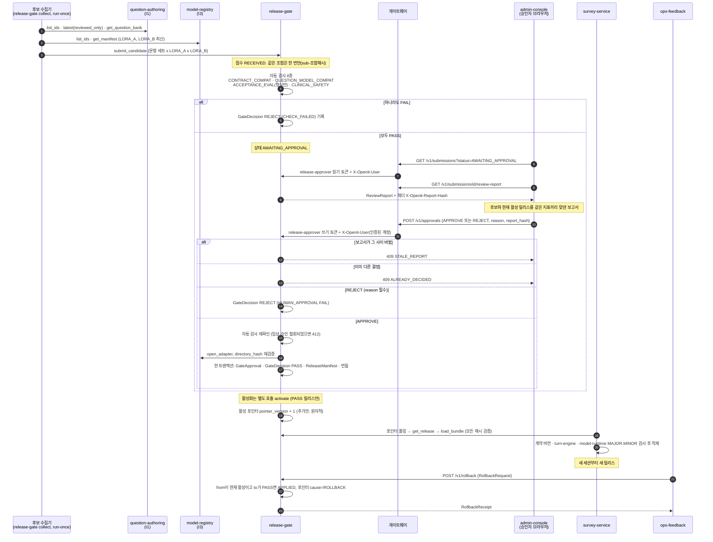

제출 상태기계는 다음과 같다.

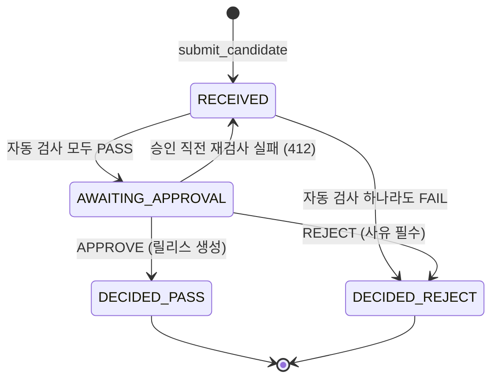

| 항목 | 상태 |
|---|---|
| 수집기 → 자동 검사 → AWAITING_APPROVAL → review-report → 승인 → 릴리스·번들 → 활성화 | [확인됨] 승인자는 [시험용 대체](스크립트가 시험용 `release-approver` 토큰으로 결정). 승인 전 PASS 없음, operator 403, 낡은 `report_hash` 409, REJECT, 번복 409 확인 |
| 게이트웨이 경유 승인 화면 경로 (목록 → 헤더 해시 → 승인, 승인자 ID가 인증 계정으로 기록, 위조 헤더 무시) | [확인됨] E2E 4g |
| 승인 화면의 실제 브라우저 렌더링·접근성 | [미정] jsdom 시험까지 |
| 롤백 요청 → APPLIED → 서비스가 이전 릴리스로 복귀, 권한 없는 역할 403 | [확인됨] 요청 주체는 e2e가 쥔 ops-feedback 역할 토큰 |
| 운영에서 활성화(`activate`)를 누가 언제 호출하는지 | [미정] 게이트웨이는 `/v1/activate`를 닫아 둠(D70). 허용 역할은 operator(`release-gate/docs/design.md` 7절) |
| 운영 승인 평가 지표·기준 | 기준 없음: 임계치 없는 보고서가 설계(D53). 지표 카탈로그 `METRICS.md`는 [제안/가정]이며 승인자가 다듬는다 |
| 게이트웨이가 여는 승인 경로 4개: GET `/v1/submissions`, GET `/v1/submissions/*`, POST `/v1/approvals` (+ 화면) | [확인됨] 제출 접수·활성화·롤백·릴리스 조회는 닫혀 있음(D70) |

근거: `release-gate/docs/design.md` 2~4·6·7·9절, `boundary-contracts/HTTP.md`(I5), `deploy/config/Caddyfile`, `deploy/docs/STATUS.md`(넷째, 여덟째 구간), D30, D42, D53, D58, D69, D70.

---

## 7. 도식 F: 비식별·피드백 흐름

원본 Trace는 비식별 처리기만 읽고, 실패 사례(FailureCase)는 항상 비식별 뒤에만 만든다(D15). 기본 방침은 "허용 목록만 남기고 자유 문자열은 전부 마스킹"이다.

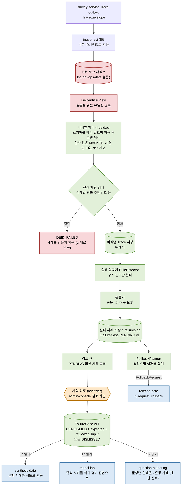

게이트웨이와의 관계: 브라우저(검토 화면)에 열리는 경로는 `GET /v1/cases*`, `GET /v1/deidentified-traces/*`(읽기 토큰), `POST /v1/cases/*/review`(`reviewer` 쓰기 토큰)뿐이다. 원본을 받는 `POST /v1/traces`와 서비스 내부 면은 게이트웨이가 열지 않는다(`Caddyfile`, D71).

| 항목 | 상태 |
|---|---|
| 수집(ACCEPTED/DUPLICATE) → 비식별 잡 run-once → FailureCase 생성 → 비식별 Trace 검증 | [확인됨] 봉투는 e2e가 만든 시험 자료 [시험용 대체] |
| 검토 HTTP (잘못된 expected 400, 읽기 토큰 403, 없는 사례 404, 신규 201, 같은 검토 재전송 200) | [확인됨] E2E 7단계 |
| `reviewed_by`가 인증 계정으로 기록되고 위조 `X-Openit-User`는 무시 | [확인됨] E2E 7h |
| 원본에 대한 접근을 소스 수준에서 막는 시험 | [구현됨] `tests/test_raw_access.py` |
| 탐지 규칙은 구조 필드(턴 실패 신호, 커밋 오류, 생성기 폴백, 파서 빈 결과 등)만 봄. 의미적 오류는 못 잡음 | [구현됨] 모델 기반 탐지기와 사람 신고 경로는 [미정] (후속 구간) |
| 발화 문장의 보존: 잠정 B안 = 검토자가 개인정보를 빼고 고쳐 쓴 `reviewed_input`만 보존. 원문은 보존하지 않음 | [제안/가정] D55, D57 (사용자가 잠정 승인). 법적 근거 확인 전 원문 보존(C)은 하지 않음 |
| 원본 로그의 보관 기간·접근 통제 | [미정] D57: 지금은 고려하지 않음 |
| 실패 유형 분류체계 | [미정] 코드에 값이 없고 설정(`rule_to_type`, `default_failure_type`)으로만 받음 |
| 롤백 기준(`window_hours`, `min_turns`, `max_failure_rate`) | [미정] 기본값 없음, 사용자 결정 |
| 지표 대시보드, 피드백 배포기 | [미정] ops-feedback 범위 밖으로 남겨 둠 |

근거: `ops-feedback/docs/design.md` 1·3~10·12절, `boundary-contracts/HTTP.md`(I6, I7), `deploy/config/Caddyfile`, D15, D16, D25, D52, D55, D57, D71.

---

## 8. 도식 G: 배포 구성도

단일 서버, Docker Compose, 외부 입구는 게이트웨이 하나다(D11). 이미지는 이름이나 태그가 아니라 digest로만 참조한다(D07, `deploy/compose.yaml` 머리말). 호스트 포트를 여는 것은 게이트웨이뿐이다(기본 `127.0.0.1:8080`).

### 8.1 Compose 서비스, 네트워크, 볼륨

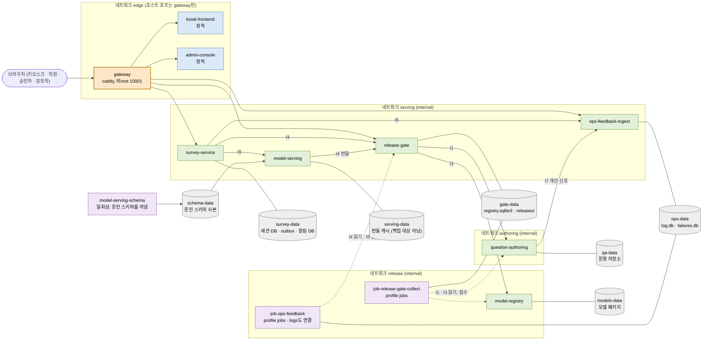

네트워크 소속은 `compose.yaml`의 `networks:`를 그대로 옮긴 것이다. 이 그림은 가독성을 위해 한 서비스를 한 상자에만 두었다. 실제로는 여러 네트워크에 걸친 것이 있다.

| 서비스 | 붙는 네트워크 | 볼륨 (쓰기는 소유 서비스만) |
|---|---|---|
| gateway | edge, serving (승인 경로 프록시용) | tmpfs만 |
| kiosk-frontend, admin-console | edge | 없음 |
| survey-service | edge, serving | survey-data |
| model-serving | serving | serving-data, schema-data(읽기 전용) |
| release-gate | serving, release | gate-data |
| ops-feedback-ingest | serving, logs, authoring | ops-data |
| question-authoring | authoring, release | qa-data |
| model-registry | release | models-data |
| job-ops-feedback | logs, release | ops-data, 잡 설정(읽기 전용) |
| job-release-gate-collect | release | gate-data |

보안 기본값(`x-hardening`): `no-new-privileges`, `cap_drop: ALL`, 읽기 전용 루트, `/tmp`는 tmpfs, 로그는 표준 출력(json-file 회전), 비root 실행. 이웃 저장소 볼륨은 공유하지 않고 HTTP와 영역별 토큰으로만 읽는다(D50). `release`와 `logs`는 `internal: true`다. 비밀 값은 `secrets/*.env`와 `secrets/gateway-*.caddy`에서 환경 변수와 Compose `configs`로 주입하며 이 문서는 변수 이름만 적는다.

상태: Compose 기동, 네트워크 도달·차단 검사(survey→qa, survey→model-registry, qa→ops, ops→qa 등 차단), healthz/readyz, 이미지 라벨 6개, 백업·삭제·복구 [확인됨] (E2E 9단계). 운영 도메인·TLS는 [미정]이다(게이트웨이는 `auto_https off`, HTTP만).

### 8.2 게이트웨이: 경로, 인증, 역할, 토큰 주입

브라우저에는 서버 토큰을 두지 않는다. 게이트웨이가 사람 인증(기본 인증, 개발·E2E용)이나 경로 규칙에 따라 서버 토큰을 붙인다(D65, D69, D71). 토큰 변수의 이름만 적는다.

| 경로 | 사람 인증 · 역할 | 전달 대상 | 붙이는 토큰(환경 변수 이름) | 비고 |
|---|---|---|---|---|
| `/healthz`, `/readyz` | 없음 | 게이트웨이 자체 응답 | - | |
| `/v1/sessions`, `/v1/sessions/*` (키오스크 공개 API) | 없음 (토큰만) | survey-service | `SURVEY_KIOSK_TOKEN` | 개입 경로는 아래 행이 먼저 잡음 |
| `/v1/staff/*`, `/v1/sessions/*/intervention` | 직원 기본 인증 | survey-service | `SURVEY_STAFF_TOKEN` | SSE: 버퍼링 끔, 읽기 제한 1시간 |
| GET `/v1/submissions`, `/v1/submissions/*` | 사람 계정, 역할 `release-approver` | release-gate | `GATE_APPROVER_READ_TOKEN` | `X-Openit-User`에 인증된 계정, 응답 `Cache-Control: no-store`, `X-Openit-Report-Hash` 통과 |
| POST `/v1/approvals` | `release-approver` | release-gate | `GATE_APPROVER_TOKEN` | 같음. 다른 역할은 403 |
| GET `/v1/cases`, `/v1/cases/*`, `/v1/deidentified-traces/*` | 사람 계정, 역할 `reviewer` | ops-feedback-ingest | `OPS_REVIEWER_READ_TOKEN` | |
| POST `/v1/cases/*/review` | `reviewer` | ops-feedback-ingest | `OPS_REVIEWER_WRITE_TOKEN` | |
| `/admin/*` | 사람 계정 (어느 역할이든) | admin-console | - | `/admin/` 접두사를 떼고 전달. API는 위 행에서 역할로 막힘 |
| `/staff/*` | 직원 기본 인증 | kiosk-frontend | - | 직원 콘솔 정적 화면 |
| 그 밖의 `/v1/*` | - | - | - | 404 (활성화, 롤백, 릴리스 조회, 제출 접수, `POST /v1/traces` 등은 닫힘, D70, D71) |
| 그 밖의 경로 | 없음 | kiosk-frontend | - | 키오스크 정적 화면 |

사람 계정과 역할 매핑(`release-approver`, `reviewer`)은 비밀 파일(`secrets/gateway-human-auth.caddy`)에 있어 이 문서는 읽지 않았다. 직원 콘솔 계정은 사람 계정과 분리한다. 게이트웨이가 클라이언트가 보낸 `X-Openit-User`를 덮어쓰는 것은 E2E 4g, 7h에서 [확인됨]이다. 운영 인증 방식(SSO, 사내망 제한 등)은 [미정]이다.

### 8.3 레지스트리와 digest 잠금

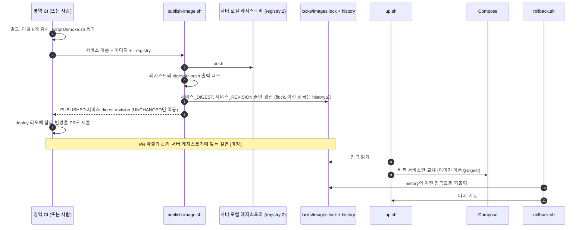

- 코드 축은 이미지 digest 잠금(`deploy/locks/images.lock`)을, 내용 축은 릴리스 활성 포인터(release-gate)를 되돌린다(D07). 두 축은 계약 버전으로 만나고 로더는 지원하지 않는 계약 버전의 묶음을 거부한다.
- 잠금 파일에는 서비스 이미지 8개의 digest와 revision, 외부 이미지(gateway의 caddy, 레지스트리, 유틸 python) digest가 있다. 서비스 이름 목록은 `survey-service`, `question-authoring`, `ops-feedback`, `release-gate`, `model-registry`(model-lab 소스), `model-serving`(model-runtime 소스), `kiosk-frontend`, `admin-console`(`deploy/docs/ci.md`).
- 레지스트리(`compose.registry.yaml`)는 `registry:2`에 인증·TLS가 없어 `127.0.0.1:5000`에만 바인드한다(운영). 볼륨 `registry-data`.
- 주기 잡은 상시 서비스가 아니라 `scripts/scheduler.py`가 `docker compose run --rm <잡>`으로 한 번 실행한다(D39). `config/jobs.yaml`의 잡 목록: `ops-feedback-job`, `backup`, `release-gate-collector`(이상 `where: serving`)와 `release-gate-worker`, `synthetic-data`, `model-lab-pipeline`(이상 `where: gpu-external`, 이 스케줄러는 실행하지 않음). 모든 `interval_seconds`가 `null`이라 주기는 [미정]이다.
- 상태: 게시·잠금·멱등·코드 축 롤백은 `scripts/test-publish.sh`와 E2E 9단계에서 [확인됨] (잠금의 digest는 개발 PC의 임시 레지스트리에서 게시한 값이다. 다른 서버에서는 `publish-images.sh`로 다시 만든다).

근거: `deploy/compose.yaml`, `compose.registry.yaml`, `compose.test.yaml`(시험 구성만), `deploy/config/Caddyfile`, `config/jobs.yaml`, `locks/images.lock`, `docs/design.md` 1~4절, `docs/ci.md`, `docs/SETUP.md`, `docs/runbook.md`, D07, D11, D24, D39, D49, D50, D65, D69, D70, D71.

---

## 9. 도식 H: 서버 배치와 환경

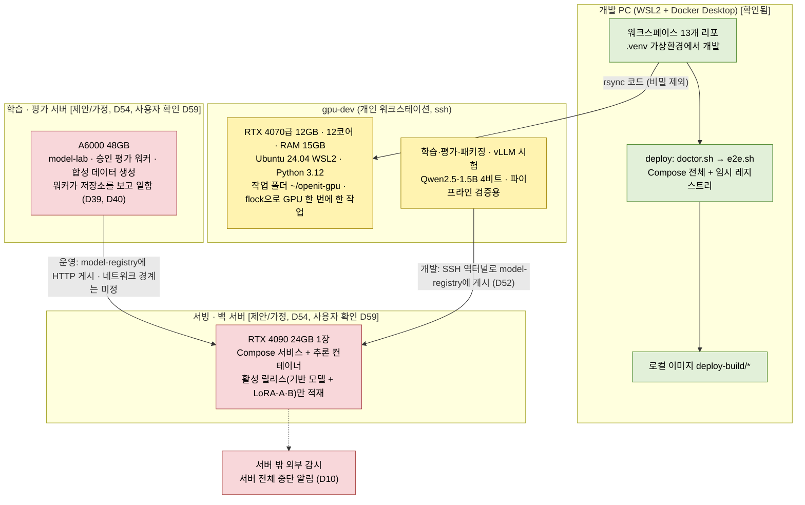

| 환경 | 사실 | 상태 | 근거 |
|---|---|---|---|
| 개발 PC (WSL2, Docker Desktop) | 서비스끼리 실제 HTTP로 도는 E2E 전체 모드 87 PASS / 0 FAIL, `--fast` 59 PASS. 표준 `docker` 경로 하나로 동작(우회 코드 제거, 열셋째 구간) | [확인됨] | `deploy/docs/STATUS.md`, `docs/SETUP.md`, `PROJECT_STRUCTURE.md` 5절 |
| 임시 서버 형태 점검 | 형제 리포 13개를 임시 폴더에 clone해 `e2e.sh --fast` 통과(60 PASS), 소스 없는 deploy 사본과 digest 이미지만으로 운영 구성 기동 | [확인됨] | `check-relocatable.sh`, `check-standalone.sh` (열한째 구간) |
| gpu-dev | 개발용 GPU 호스트. 12GB 값은 설정 프로파일(`model-runtime/profiles/gpu-dev-12g.json`)로 뺌. 결과는 파이프라인 검증용. 학습·평가·패키징·게시 한 바퀴와 vLLM(LoRA + 구조화 출력, 두 어댑터)을 직접 확인 | [확인됨] gpu-dev에서. E2E의 일부는 아님(`E2E_GPU=1` 경로는 미검증) | D47, D48, `model-runtime/docs/design.md` 11절 |
| gpu-dev에서의 전체 시험 | `PROJECT_STRUCTURE.md`는 "서버(gpu-dev)에서의 전체 시험은 진행 중"이라 적었다. 그러나 D47(2026-10-15)은 gpu-dev에 Docker가 없다고 적었고, 그 뒤 Docker 설치 여부를 이 문서가 읽은 파일에서 확인하지 못했다 | [미정] 진행 상황과 환경 확인 필요 | `PROJECT_STRUCTURE.md` 112줄, D47 |
| 서빙·백 서버 | RTX 4090 24GB 1장, Compose 서비스 + 추론 컨테이너. 프로파일 `rtx4090-24g.json`은 잠정. 기반 모델 크기와 배치에서만 쓰임 | [제안/가정] 사용자가 맞다고 확인(D59), 실물 실측 없음 | D54, D59, `model-runtime/profiles/` |
| 학습·평가 서버 | A6000 48GB. 학습은 워커 방식으로 서빙 서버의 model-registry에 게시. 서빙 서버는 외부 호출을 받지 않음 | [제안/가정] | D40, D54 |
| 추론 서버 컨테이너 | CPU/fake 변형은 E2E에 사용. GPU 변형 이미지는 개발 PC에서 빌드됨(13.1GB). 컨테이너 안 GPU 추론은 이 문서가 읽은 파일에서 확인하지 못함 | CPU/fake [확인됨], GPU [구현됨] 또는 [미정] | `model-runtime/docs/STATUS.md` 8차, `deploy/docs/STATUS.md` |
| 실제 GPU 모델 E2E (RTX 4090 실측) | 하지 않음 | [미정] | `PROJECT_STRUCTURE.md` 5절 |
| 백업·복구 | 자동 백업·시험된 복구 스크립트는 deploy에 있는 선택 기능. 요구된 적 없음. 간격·서버 밖 저장 위치 미정 | 스크립트 [확인됨] (E2E 9단계), 설정 [미정] | D56, D59, `config/backup.env.example` |
| 고가용성·대기 서버·현장 대체 절차 | 범위 밖. 서버 전체 중단은 비보증, 외부 감시가 알림 | [제안/가정] | D10, D56 |

근거: D10, D40, D47, D48, D52, D54, D56, D59, D61, `head/docs/STRUCTURE.md` 9절, `deploy/docs/SETUP.md`, `deploy/config/jobs.yaml`.

---

## 10. 도식 I: 계약·버전 관계

버전 축이 서로 다르다. 같은 것으로 세지 않는다.

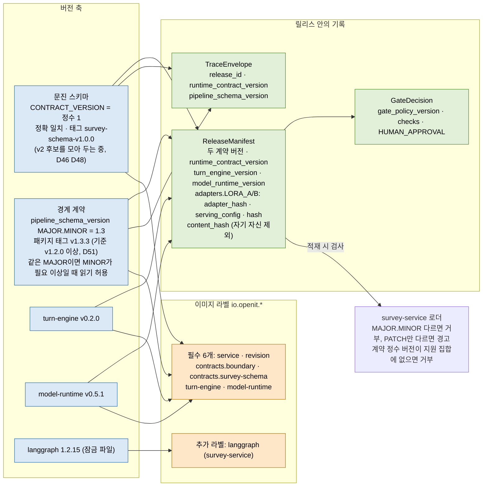

| 축 | 값(2026-10-26 읽은 기준) | 규칙 | 근거 |
|---|---|---|---|
| 문진 스키마 | 정수 `1`(`survey-service/schema/CONTRACT_VERSION`), 태그 `survey-schema-v1.0.0` | 정확 일치. 바뀌면 survey-service가 반영(D21). v2 후보(고정 문장 정보, 도움 요청 사유, `pending_id_seed`, 조건 규칙을 oneOf로 표현)는 모아서 한 번에 올림 | D14, D21, D46, D48 |
| 경계 계약 | 스키마 `1.3`, 패키지 태그 `v1.3.3`(태그 목록 v1.0.0 ~ v1.3.3). deploy `lib.sh`의 기본 태그도 v1.3.3. 단 synthetic-data(호스트 실행)는 v1.2.0을 고정해 쓴다 | MINOR는 추가만. 쓰는 쪽은 엄격, 읽는 쪽은 모르는 필드·열거값 허용. 의미 변경은 새 필드로. 모든 레코드는 불변 | D14, D25, D26, D42, D43, D51, D58, D66, D68 |
| turn-engine | v0.2.0 (1205 passed, 골든 868쌍 중 806쌍 일치) | 출력이 달라지면 MINOR | D44 |
| model-runtime | v0.5.1 (태그 v0.2.0 ~ v0.5.1) | 라이브러리와 추론 서버(I9)를 같은 리포가 가짐 | D45, D62 |
| 라이브러리 설치 | Git 태그. 이미지 빌드 때 태그를 고정하고 의존 버전은 잠금 파일로 고정 | `pip install git+ssh://…@태그`. 별도 패키지 인덱스 서버 없음 | D18, 루트 `CLAUDE.md` |
| 해시 | JCS(RFC 8785) 정규화 + SHA-256, 기준 구현은 `boundary_contracts.canonical` | 클라이언트가 응답을 읽을 때 해시를 다시 계산 | D20, D34, D49 |
| 이미지 라벨 | 필수 6개는 해당하는 것만(kiosk-frontend는 turn-engine·model-runtime 라벨 불필요). 추가 라벨 허용 | 존재만 검사 | D50, D63, D66 |
| 공개 API | `PUBLIC_API.md`(경계 계약 v1.3.2에서 확정, 상태 코드 표 포함) | `turn_id`는 API 봉투 필드. 문진 스키마는 바꾸지 않음 | D55, D58, D66 |

주의: 문서 사이의 표기 차이를 읽다 발견했다. `boundary-contracts/README.md`의 설치 예시는 `v1.1.1`이고 루트 `CLAUDE.md`의 예시는 `v1.0.0`이다. 현재 기준 태그는 `deploy/scripts/lib.sh`의 v1.3.3이다(`deploy/docs/SETUP.md` 증상표도 같은 태그를 든다). 문서 정리는 헤드의 일이며 이 문서는 건드리지 않았다.

---

## 11. 알려진 빈 곳과 미정

문서에서 확인한 것만 적었다. 결정 번호나 파일 경로가 근거다.

| # | 항목 | 지금 상태 | 근거 |
|---|---|---|---|
| 1 | 운영 도메인, TLS(HTTPS) | 게이트웨이는 `auto_https off`, HTTP만. STT와 웹 푸시는 보안 출처가 필요하다 | `Caddyfile` 주석, `deploy/docs/STATUS.md` |
| 2 | 직원 콘솔·사람 계정의 운영 로그인 | 기본 인증은 개발·E2E용. 운영 방식(SSO, 사내망 제한 등) 미정 | `Caddyfile` 주석, D69 |
| 3 | CI가 서버 로컬 레지스트리에 닿는 방법 | 후보 (a) self-hosted runner (b) 사설망·VPN (c) SSH 터널. 레지스트리에 인증·TLS 없음 | `deploy/docs/ci.md` 3절, D24 |
| 4 | 토큰 발급·회전 | 미정 | `PROJECT_STRUCTURE.md` 5절 |
| 5 | 실제 GPU 추론 (RTX 4090, 컨테이너 안) | gpu-dev의 시험까지. E2E는 fake 백엔드. `E2E_GPU=1` 미검증 | D47, D48, `deploy/docs/STATUS.md` |
| 6 | 운영 기반 모델 선택 | AI 학습 담당자의 몫, 임시는 Qwen2.5-1.5B 4비트 | D47, D61 |
| 7 | 실제 브라우저 화면 동작 | 자동 시험은 jsdom·상태 기계·클라이언트까지. 승인 화면, 검토 화면, 키오스크 화면 모두 | `kiosk-frontend`, `admin-console` STATUS, E2E BLOCKED |
| 8 | 한국어 STT 정확도, 웹 푸시 수신 | STT는 브라우저 Web Speech API 기본이나 정확도 미확인. 푸시는 VAPID 키와 HTTPS 필요 | D65, D64, `survey-service/docs/design.md` 15절 |
| 9 | 원본 로그 보관 기간과 접근 통제 | 지금은 고려하지 않음(D57). 원문 보존(C안)은 하지 않음 | D55, D57 |
| 10 | 실패 유형 분류체계, 롤백 기준(실패율·창·최소 턴) | 코드에 기본값 없음, 설정으로만 | `ops-feedback/docs/design.md` 6·9·12절 |
| 11 | 비식별 기준(남길 키, 정의 목록, 패턴) | 시험·시연용 보수적 예시. 운영 값은 사용자 결정 | `ops-feedback/docs/design.md` 4.1절 |
| 12 | 승인자가 보는 지표 카탈로그와 통과 기준 | 임계치 없음이 설계. `METRICS.md`는 제안이며 담당자가 다듬음. 금지 표현률 지표는 만들지 않음 | D53, D59 |
| 13 | 주기 잡의 스케줄 주기 | `config/jobs.yaml`의 모든 `interval_seconds`가 null | `deploy/config/jobs.yaml` |
| 14 | 백업 설정(간격, 서버 밖 저장 위치), 외부 감시 | 스크립트는 있으나 설정 없음. 백업은 요구된 적 없는 선택 기능 | D10, D56, D59 |
| 15 | 활성화(`activate`)의 운영 호출 주체 | 게이트웨이가 닫아 둠. 허용 역할은 operator. 누가 언제 호출하는지 문서에 없음 | D70, `release-gate/docs/design.md` 7절 |
| 16 | 문항 저작 화면 | admin-console의 후속 화면 목록에만 있음. 저작 API와 서비스는 있음 | D8, D68, `admin-console` STATUS |
| 17 | 모델 기반 실패 탐지기, 사람 신고 경로 | 후속 구간 | `ops-feedback/docs/design.md` 5절 |
| 18 | 문진 스키마 v2 | 후보만 모아 둠 | D46, D48 |
| 19 | Trace 크기: Trace가 세션 문서 전체를 담아 턴이 늘수록 커짐 | 스키마가 정한 필드라 줄이지 않았다. 문제가 되면 ops-feedback과 협의 | `survey-service/docs/design.md` 6절 |
| 20 | gpu-dev에서의 전체 시험 | `PROJECT_STRUCTURE.md`는 진행 중이라 적었으나 D47의 "Docker 없음"과 어긋나 보임 | 9절 참고 |
| 21 | LangGraph 그래프의 18개 외 노드 | 설계서에 "약 20개"라고만 적혀 있어 이름은 확인하지 못함 | 5절 |
| 22 | 서빙 서버의 단일 장애 지점 | 고가용성은 범위 밖 | D10 |
| 23 | 데이터셋 저장소의 서버 위치 | 데이터셋(I2)은 같은 호스트의 파일 저장소. 운영의 호스트 간 이동 방식 미정(개발은 rsync) | D49, D52 |
| 24 | GPU 서버가 서빙 서버 model-registry·저작·ops 읽기 면에 닿는 길 | 개발은 SSH 역터널. 운영의 공개 포트·터널 여부 미정 | D52, `deploy/docs/design.md` 1절 |

이 문서가 읽지 않은 것: 각 영역의 소스 코드(`survey_service/graph.py` 등), `secrets/` 아래 모든 파일, 환경 변수의 값. 도식의 노드·간선은 설계 문서와 STATUS에서 읽은 내용이며, 코드와의 일치는 각 영역의 시험이 보증하는 범위를 넘어 확인하지 않았다.
