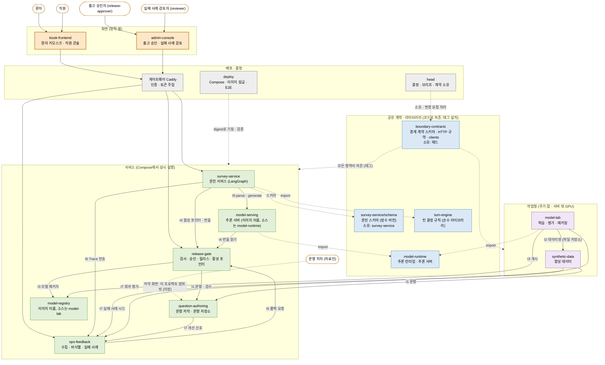
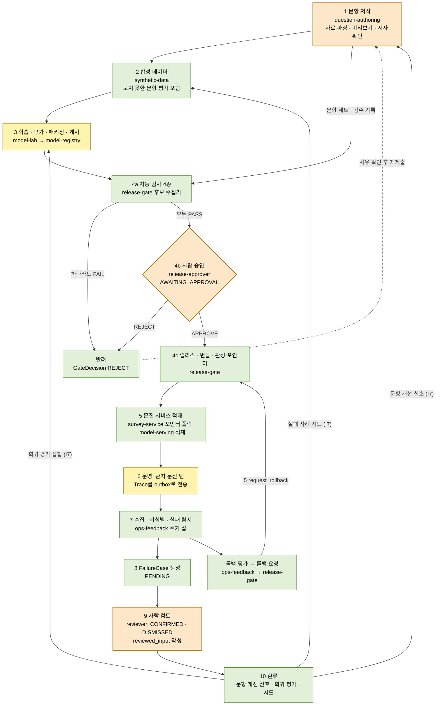
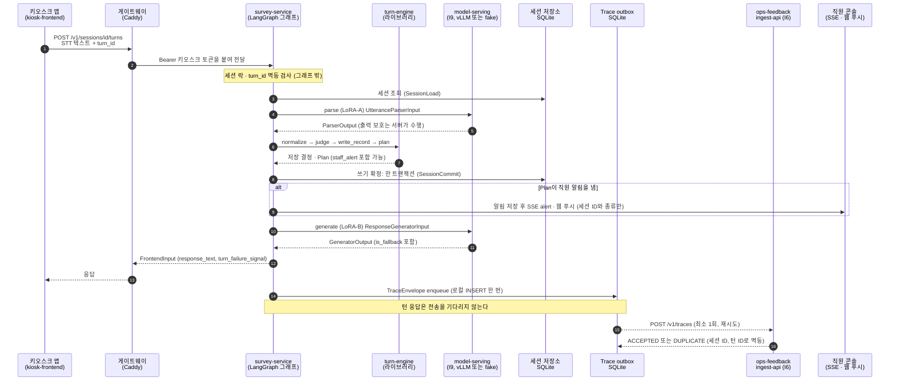
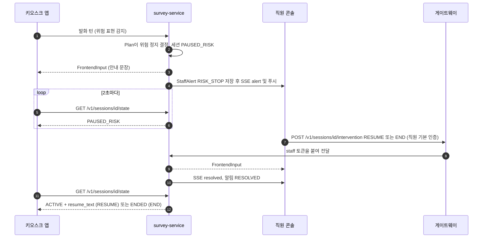

# 아키텍처: 흐름, 시퀀스, 상태, 배포

이 문서는 문진 시스템 워크스페이스(리포 13개)의 지금까지 알려진 구조를 도식으로 보여 준다. 리포별 목록과 큰 흐름 한 장은 [`PROJECT_STRUCTURE.md`](PROJECT_STRUCTURE.md)가 다룬다. 이 문서는 그것이 다루지 않는 영역 의존 지도, 순환 파이프라인의 단계, 한 턴의 시퀀스, 그래프, 출고 승인, 비식별, 배포, 서버 배치, 버전 관계를 깊이 다룬다. 결정의 근거는 [`DECISIONS.md`](DECISIONS.md)(D01~D71), 계약은 `../../boundary-contracts/`의 `INTERFACES.md`, `HTTP.md`, `PUBLIC_API.md`, `CONVENTIONS.md`, `METRICS.md`에 있다.

작성 기준일은 2026-10-26이다. 이 문서의 모든 도식은 아래 파일을 읽고 그렸다. 서비스와 도커는 실행하지 않았다.

## 0. 상태 표시와 읽는 법

각 도식과 표의 항목에는 확인 수준을 붙였다.

| 표시 | 뜻 |
|---|---|
| [확인됨] | 서비스끼리 실제 HTTP로 도는 전체 시험(`deploy/scripts/e2e.sh`, 전체 모드 87 PASS / 0 FAIL, 개발 PC)에서 확인 |
| [구현됨] | 해당 리포의 단위·스모크 시험으로만 확인. 서비스끼리 E2E로는 확인하지 못함 |
| [제안/가정] | 설계의 제안이거나 사용자가 가정으로 정한 것. 바뀔 수 있음 |
| [미정] | 결정이 필요하거나 확인하지 못한 것 |
| [시험용 대체] | E2E에서 가짜 백엔드, 시험용 어댑터, 시험용 토큰 등으로 대신한 것 (`TEST-SUB`) |

도식 아래의 "근거"는 그 도식을 그릴 때 읽은 파일과 결정 번호다. 경로는 워크스페이스 루트(`healthKiosk/`) 기준이다.

참고: `head/docs/STATUS.md`는 2026-10-15 상단의 "현재 단계" 문구가 오래되었다(구조 확정 단계로 적혀 있음). 이 문서는 STATUS.md의 완료 목록과 `deploy/docs/STATUS.md`, `PROJECT_STRUCTURE.md` 5절의 최신 내용을 따랐다.

## 1. 한눈에 보는 다이어그램 목록

| 도식 | 절 | 내용 |
|---|---|---|
| A | 2 | 영역·리포 의존 지도 |
| B | 3 | 큰 순환 파이프라인 |
| C | 4 | 운영 한 턴 시퀀스 |
| D | 5 | survey-service LangGraph 그래프 |
| E | 6 | 출고 승인 시퀀스와 제출 상태 |
| F | 7 | 비식별·피드백 흐름 |
| G | 8 | 배포 구성도 (Compose, 게이트웨이, 레지스트리) |
| H | 9 | 서버 배치와 환경 |
| I | 10 | 계약·버전 관계 |
| - | 11 | 알려진 빈 곳과 미정 |

---

## 2. 도식 A: 영역·리포 의존 지도

리포는 13개이고 의존은 한 방향이다: 문진 스키마와 boundary-contracts, 그 위에 turn-engine과 model-runtime, 그 위에 영역 리포(D02, STRUCTURE.md 5절). 영역 사이 호출은 코드를 가져오는 대신 HTTP 서비스 API로 한다(D49). 가장자리 영역은 사람 또는 다른 팀과 맞닿는 곳이다: 환자 키오스크 화면(`kiosk-frontend`, 떼어 낼 수 있는 별도 영역, D65), 직원 콘솔, 출고 승인과 실패 사례 검토를 하는 사람(`admin-console`, D68), 문항 저자.

해석:

- 실선은 런타임 HTTP 호출(I번호는 `INTERFACES.md`), 점선은 빌드 시 의존이나 소유 관계다.
- I2(데이터셋)는 HTTP가 아니라 같은 호스트(GPU 호스트)의 파일 저장소다(D49).
- 상태: 서비스끼리의 HTTP 연결은 [확인됨]. 단 모델은 [시험용 대체](가짜 백엔드)이고, `model-lab`의 실제 학습은 gpu-dev에서 따로 한 바퀴 확인했을 뿐 E2E에는 시험용 어댑터가 쓰였다. 문항 저작 화면은 구현 범위 밖이다.
- 키오스크 프론트(`kiosk-frontend`)는 다른 팀 담당이던 외부 접점을 분리 가능하게 만든 것이다(D12, D65). 이 리포를 통째로 바꿔도 나머지는 영향받지 않는 것이 목표다.

근거: `head/docs/STRUCTURE.md` 3~6절, `PROJECT_STRUCTURE.md` 1~3절, `deploy/compose.yaml`, `boundary-contracts/HTTP.md`, D02, D05, D12, D49, D65, D68.

---

## 3. 도식 B: 큰 순환 파이프라인

문항에서 시작해 모델과 릴리스를 거쳐 운영에 이르고, 운영에서 나온 실패 사례가 다시 문항·데이터·평가·롤백으로 돌아오는 고리다. 단계 번호는 `head/docs/E2E.md`의 합격 시나리오 1~9와 같다. 모델 성능은 이 순환의 완성 기준이 아니다(D38, D61): 순환이 닫히는지만 본다.

| 단계 | 상태 | 비고 |
|---|---|---|
| 1 문항 저작 | [확인됨] I1 HTTP 읽기·검수·변경 분류까지 | 저작 화면은 구현 범위 밖 [미정], 지원 문서 형식은 영역이 정함(D33) |
| 2 합성 데이터 | [확인됨] run-once, 평가가 학습과 겹치지 않음 | 규칙 기반 생성기. LLM 생성기는 후속 |
| 3 학습·평가·패키징 | [시험용 대체] E2E는 시험용 어댑터·고정 지표 보고서 | gpu-dev에서 Qwen2.5-1.5B 4비트로 한 바퀴는 별도 확인(STATUS.md 2026-10-15). `E2E_GPU=1` 경로는 미검증(기본 끔) |
| 4 검사·승인·릴리스 | 자동 검사·릴리스·번들·활성화 [확인됨], 승인자는 [시험용 대체](스크립트가 시험용 토큰으로 결정) | 승인 화면은 admin-console, 게이트웨이 경유 한 번은 E2E 4g에서 확인 |
| 5 서비스 적재 | [확인됨] 실제 survey-service가 포인터를 폴링해 적재 | 모델은 가짜 백엔드 [시험용 대체] |
| 6 운영 턴 | [확인됨] 게이트웨이 경유 공개 API 한 턴 | 한국어 STT 등 실제 브라우저 경로는 [미정] |
| 7~8 수집·비식별·사례 | 수집·잡·FailureCase [확인됨] | 봉투는 E2E가 만든 시험 자료 [시험용 대체] |
| 9 사람 검토 | 검토 POST·`reviewed_input`·`reviewed_by` [확인됨] (E2E 7g, 7h) | 검토 화면 렌더링은 [미정] |
| 10 환류 | synthetic-data의 I7 시드 인용과 question-authoring의 개선 신호(`GET /v1/signals`)는 [확인됨] (E2E 7단계). model-lab의 확정 사례 회귀 평가는 [구현됨]이며 E2E에서는 실행하지 않음 | `deploy/docs/STATUS.md` 셋째·일곱째 구간, D52, CR-D12 |
| 롤백 | [확인됨] 요청 → APPLIED → 서비스가 이전 릴리스로 복귀 | 자동 판단 기준(실패율, 최소 턴)은 사용자 결정 전이라 기본값 없음 [미정] |

근거: `head/docs/E2E.md`, `deploy/docs/STATUS.md`(넷째~열째 구간), `release-gate/docs/design.md` 2~4·9절, `ops-feedback/docs/design.md` 9절, D32, D38, D52, D53, D57, D61.

---

## 4. 도식 C: 운영 한 턴 시퀀스

환자의 발화 하나를 처리하는 한 턴이다. 브라우저는 게이트웨이만 부른다. 게이트웨이가 경로에 맞는 서버 토큰을 붙인다(키오스크 경로는 `SURVEY_KIOSK_TOKEN`, 직원 경로는 `SURVEY_STAFF_TOKEN`; 토큰 값은 이 문서에 없다).

### 4.1 위험 정지와 재개

| 항목 | 상태 | 근거 |
|---|---|---|
| 게이트웨이 경유 공개 API 한 턴, 같은 `turn_id` 재전송 시 같은 응답 | [확인됨] | E2E 5단계, `PUBLIC_API.md` |
| parse·generate가 model-serving을 거침 | [확인됨] 고정 출력 "(가짜 응답)" 확인, 모델은 [시험용 대체] | `deploy/docs/STATUS.md` 다섯째 구간 |
| 추론 서버를 멈추면 그 턴만 실패하고 서비스는 살며, 다시 띄우면 다음 턴이 복구 | [확인됨] | 같은 곳 |
| Trace outbox 전송, DUPLICATE도 전달 완료로 취급 | [확인됨] (봉투는 E2E가 만든 시험 자료) | `survey-service/docs/design.md` 6절, D16 |
| 위험 정지 → 직원 RESUME/END → state ACTIVE+resume_text → 알림 RESOLVED, SSE alert/resolved | [확인됨] 위험 문구 스위치는 시험 구성 전용(`TEST-RISK`) [시험용 대체] | E2E 5f, `compose.test.yaml` |
| 웹 푸시 수신 (VAPID 키, HTTPS 필요) | [미정] BLOCKED. 키가 없으면 푸시 없이 SSE만 동작 | `survey-service/docs/design.md` 15절, D64 |
| 직원 알림이 안 닿으면 `DELIVERY_FAILED`, 프론트는 현장 직원 호출 화면 | [구현됨] | `PUBLIC_API.md`, `design.md` 15절 |
| 처리 표(세션 상태 × 입력 종류) | [구현됨] 골든 대조 1220쌍 중 1215 일치, 5건은 예시 오류 | `design.md` 3절, D44 |

설명:

- 모델은 해석(파서)과 문장 생성만 하고, 판단은 turn-engine 코드가 한다(STRUCTURE.md 5절 규칙 11).
- 쓰기 확정이 실패하면 확정 뒤의 일은 하지 않는다. 확정 뒤의 일(직원 알림, 결과 전달, 응답 생성)은 서로의 성패와 무관하게 시도한다(`design.md` 3절 7~8항).
- 위험 정지 중인 세션은 유휴 만료로 닫지 않는다(D66).
- 새 세션만 새 릴리스에 묶이고, 진행 중 세션은 자기 릴리스로 끝까지 간다. 턴 처리 중에는 이웃(I4)을 부르지 않는다(`design.md` 5절).

근거: `survey-service/docs/design.md` 3·5·6·15절, `boundary-contracts/PUBLIC_API.md`, `HTTP.md`(I6, I9), `deploy/config/Caddyfile`, D16, D36, D55, D58, D62, D64, D66.

---

<!-- SECTION-DEF -->
